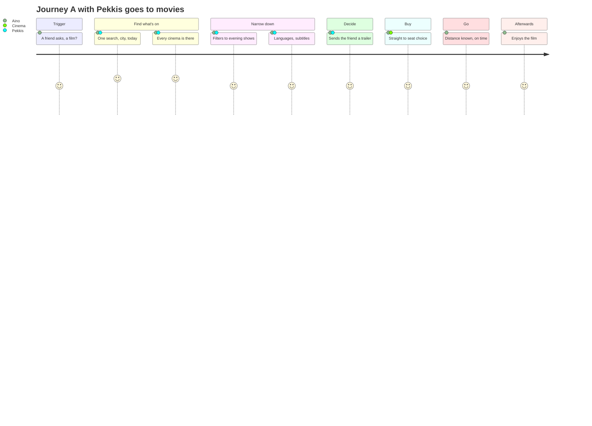
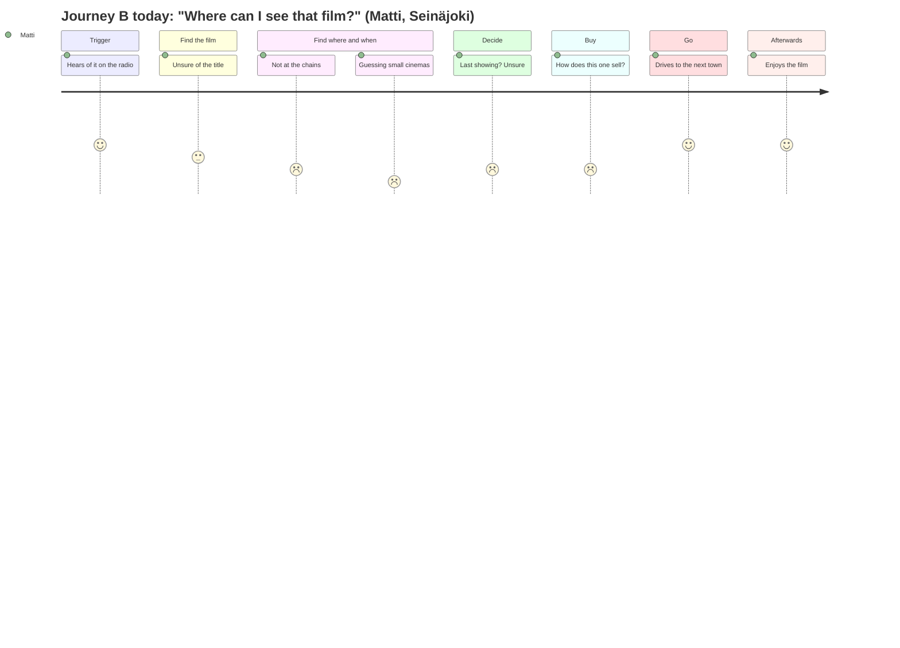

# Customer journey maps

How a person gets from "I'd like to see a film" to sitting in the cinema, today and with Pekkis goes to movies. There is one map for each of the service's two ways in: **time and place first**, and **film first** (see [AGENTS.md](../../AGENTS.md#what-this-is)).

**Status: a first draft, 2026-10-21, for the mockup presentation on 2026-10-23.** Everything here is our assumption **[A]**, not yet research. Each pain point is a hypothesis for the questionnaire and the user tests to confirm or refute. When results come in, mark the confirmed parts **[V]** with their source.

How to read a map:

- **Columns** are the stages of the journey.
- **Rows** show what the person does, thinks and feels at each stage, where they meet a service (touchpoints), what hurts (pain points), and what we can do about it (opportunities).
- **The feeling** is scored 1–5 (1 frustrated, 5 happy) and drawn as a curve. It is drawn twice: once for the journey today, and once with our service.

The diagrams are Mermaid `journey` charts. GitHub renders them in place. For slides, `pnpm design:render` writes them as PNG images next to this file (`journey-a-today.png` and so on); rerun it after editing a diagram. It also draws each journey as one slide (`journey-a-slide.png`, `journey-b-slide.png`): the stages, both feeling curves on one chart, and the thoughts, pain points and opportunities, all read from the tables below.

---

## Journey A: "Something tonight, near me" (time and place first)

**Persona: Aino, 24, a student in Jyväskylä.**

- Thursday, 16:30. Lectures are over, and a friend suggests a film tonight.
- No particular film in mind: anything that's good, starts after 18:00 and is within walking or bus distance.
- Uses a phone for everything; a student budget.
- Knows the big cinema in the city centre, but not the small ones.

**Goal:** a good show tonight, close by, with tickets bought, in a few minutes.

| Stage               | 1. Trigger                           | 2. Find what's on                                                      | 3. Narrow down                                                                                             | 4. Decide                                                                                                                          | 5. Buy                                                                                                        | 6. Go                                               | 7. Afterwards                               |
| ------------------- | ------------------------------------ | ---------------------------------------------------------------------- | ---------------------------------------------------------------------------------------------------------- | ---------------------------------------------------------------------------------------------------------------------------------- | ------------------------------------------------------------------------------------------------------------- | --------------------------------------------------- | ------------------------------------------- |
| **Does**            | Agrees to go; opens the phone        | Opens one cinema's site after another, or searches "leffat jyväskylä"  | Compares times, films, languages; asks the friend                                                          | Picks a show both can make                                                                                                         | Follows the cinema's ticket link, pays                                                                        | Walks or takes the bus; arrives in time             | Talks about the film; maybe plans again     |
| **Thinks**          | "What's on, anything good?"          | "Is there something besides Finnkino?"                                 | "Is this dubbed? What time does it end?"                                                                   | "Is it any good? Will my friend like it?"                                                                                          | "Hope there are seats left"                                                                                   | "Will we make it?"                                  | "We should do this more often"              |
| **Touchpoints**     | Messaging app                        | Each cinema's own site, search engine, social media                    | Cinemas' sites, the chat with the friend                                                                   | –                                                                                                                                  | The cinema's ticket page                                                                                      | Map app, bus                                        | Social media, chat                          |
| **Pain points**     | –                                    | One site per cinema; Finnkino's site sucks; small cinemas hard to find | No single view; languages and subtitles unclear; times spread across many tabs                             | Alternatives not seen together; trailers hunted separately                                                                         | Finnkino's site sucks ([HS 2025](https://www.hs.fi/kulttuuri/art-2000011591275.html)); every checkout differs | Distance and travel time not shown                  | Nothing to come back to                     |
| **Opportunities**   | Something to send the friend: a link | **All the cinemas in one search by place and day** (`/fi/haku`)        | **Filters by time, cinema and film; languages on every show.** Own defaults, like never dubbed (not built) | **Every option side by side, and a film page to send the friend**: synopsis, trailer; opt-in critics' scores (not on the site yet) | **Straight to the show's own purchase flow**: only seats and payment left, none of the cinema site's own maze | **Distance in the results; the map** (`/fi/kartta`) | Ideas: "coming soon", reminders (not built) |
| **Feeling today**   | 4 · interested                       | 2 · frustrated                                                         | 2 · confused                                                                                               | 3 · unsure                                                                                                                         | 2 · annoyed                                                                                                   | 3 · rushed                                          | 4 · satisfied                               |
| **Feeling with us** | 4 · interested                       | 5 · relieved                                                           | 4 · in control                                                                                             | 4 · confident                                                                                                                      | 4 · quick                                                                                                     | 4 · on time                                         | 4 · satisfied                               |

---

## Journey B: "Where can I see that film?" (film first)

**Persona: Matti, 58, lives in Seinäjoki.**

- Heard about a film on the radio: a Finnish documentary, or an old classic back on the big screen.
- Wants to know whether it plays anywhere nearby, and when; willing to drive an hour for the right film.
- Uses a laptop at home and a phone on the move.
- Doesn't know which cinemas might show it: the big chains rarely show this kind of film.

**Goal:** find where and when the film plays within reasonable distance, and not miss it.

| Stage               | 1. Trigger                                        | 2. Find the film                                      | 3. Find where and when                                                                                       | 4. Decide                                                                     | 5. Buy                                                                    | 6. Go                                 | 7. Afterwards                                                                                  |
| ------------------- | ------------------------------------------------- | ----------------------------------------------------- | ------------------------------------------------------------------------------------------------------------ | ----------------------------------------------------------------------------- | ------------------------------------------------------------------------- | ------------------------------------- | ---------------------------------------------------------------------------------------------- |
| **Does**            | Hears about the film; remembers its name, roughly | Searches the web with the name, maybe misspelt        | Checks the chains' sites, then guesses at small cinemas, film clubs, events                                  | Picks a day and a place; maybe a longer drive                                 | Follows the ticket link, or pays at the door                              | Drives to a town nearby               | Recommends it; looks for similar films                                                         |
| **Thinks**          | "That sounds like something for me"               | "What was it called in Finnish?"                      | "Is this only in Helsinki?"                                                                                  | "Is it worth the drive? Is this the last showing?"                            | "Can I buy online, or only at the door?"                                  | "Where do I park?"                    | "Where do I find more like this?"                                                              |
| **Touchpoints**     | Radio, newspaper, a friend                        | Search engine                                         | Chains' sites, small cinemas' own pages, Facebook, event calendars                                           | –                                                                             | The cinema's ticket page, or the door                                     | Car, map app                          | Friends, social media                                                                          |
| **Pain points**     | –                                                 | Finnish, Swedish and original titles differ; spelling | Finnkino's site sucks; small and touring shows hard to find                                                  | No overview of all showings; last showings missed                             | Finnkino's site sucks; booking differs by cinema                          | –                                     | No way to follow a film or a series                                                            |
| **Opportunities**   | –                                                 | **Typo-tolerant search in any title language**        | **Every showing nationwide, nearest first.** Own filters, like 35 mm prints or original versions (not built) | **The film page: all days and places** (a "last showing" mark: not shown yet) | **Straight to the show's own purchase flow**: only seats and payment left | **Address and map on the venue page** | Follow a series, like Elsis's knitting screenings (Neulekino): recognised, following not built |
| **Feeling today**   | 4 · curious                                       | 3 · unsure                                            | 1 · frustrated                                                                                               | 2 · worried about missing it                                                  | 2 · annoyed                                                               | 4 · expectant                         | 4 · satisfied                                                                                  |
| **Feeling with us** | 4 · curious                                       | 4 · found it                                          | 5 · relieved                                                                                                 | 4 · confident                                                                 | 4 · quick                                                                 | 4 · expectant                         | 4 · satisfied                                                                                  |

---

## What the maps tell us

- **The biggest gain is in finding and comparing** (stages 2–4): the scattered information is the problem both personas share. That's what the service is built around: 157 venues in 110 cities in one place.
- **Buying stays at the cinema, but with the least of its site** (stage 5): we never sell tickets, but the ticket link most often opens that very show's purchase flow on the cinema's site. Seat selection and payment are all that's left of the cinema's own site, not its navigation, search and listings (Finnkino's above all). This is one of the service's best features: in the maintainer's own use it already works this way whenever the cinema's site allows a direct link, which it most often does. Still to do: say on the link what it leads to (buy, reserve or only information; the data knows, the website doesn't say yet).
- **Small and touring cinemas** are where film-first users hurt most, and where we differ most from the chains' own sites.
- **Afterwards** (stage 7) is empty in both maps: following films, series or re-runs is a possible next step, not built.
- **A first real case** **[V]** (2026-10-21): Elsis, a regular moviegoer, wants to follow **knitting screenings** (_neulekino_: a show where knitting in the dim is welcome). The data already recognises them as a series (`neulekino` in `config/series.json`; one upcoming on 2026-10-22, at Kinopirtti in Kemi). What's missing is a way to follow a series and be told when the next one comes near. That's the "afterwards" opportunity in journey B.

## Personal settings: from moviebuff to "no spoilers"

The same service, tuned to the person. None of this is built yet **[A]**, but most of it is already in the data, so it's a matter of settings and filters, not of new sources:

| Setting                              | Who wants it                                          | What the data has                                                       |
| ------------------------------------ | ----------------------------------------------------- | ----------------------------------------------------------------------- |
| Show or hide critics' scores         | The moviebuff shows them; others never want a verdict | Rotten Tomatoes, Metacritic, IMDb (OMDb), opt-in today                  |
| Original version only, never dubbed  | Most adults; Aino                                     | `dubbed`, audio and subtitle languages per screening                    |
| Film prints and premium formats      | The moviebuff: 35 mm, 70 mm; IMAX, 4DX fans           | `projection` (35 mm, 70 mm, 16 mm) and `features` (IMAX, 4DX, Atmos, …) |
| Kinds of screenings to follow        | Elsis (knitting), parents (baby screenings), classics | Series (`neulekino`, …) and tags (`classic`, `baby`, `guest`, …)        |
| Accessibility                        | People who need captions or audio description         | Tags `captions`, `audio-description`, `accessible`                      |
| Home and favourite cinemas, a radius | Everyone who searches near the same place again       | Venue coordinates; the search already takes a place and a radius        |

Ratings stay opt-in by default (AGENTS.md); a setting only remembers the choice. Settings could live in the browser at first, with no account.

## Hypotheses to test

For the questionnaire and the user tests:

1. People check several cinemas' sites before deciding. How many, and do they know the small cinemas?
2. Language and subtitles matter when choosing (dubbed or original, subtitled or not).
3. People mostly start from time and place, not from a film. Or the other way round?
4. Distance and travel time affect the choice, and a radius in kilometres is a natural way to say "near".
5. Leaving our site to buy from the cinema is acceptable.
6. People want to be told when a film comes to a cinema near them.
7. Do people want critics' scores (Rotten Tomatoes, Metacritic, IMDb) when choosing, or avoid them before seeing a film? We have them, opt-in; the website doesn't show them yet.
8. People would set personal defaults once (never dubbed, scores on or off, home cinema) rather than filter every time. Which ones matter most, and do moviebuffs care about film prints and formats?
9. People follow kinds of screenings, not only films: knitting screenings, baby screenings, classics. Which series would they follow, and how far would they travel for one?
