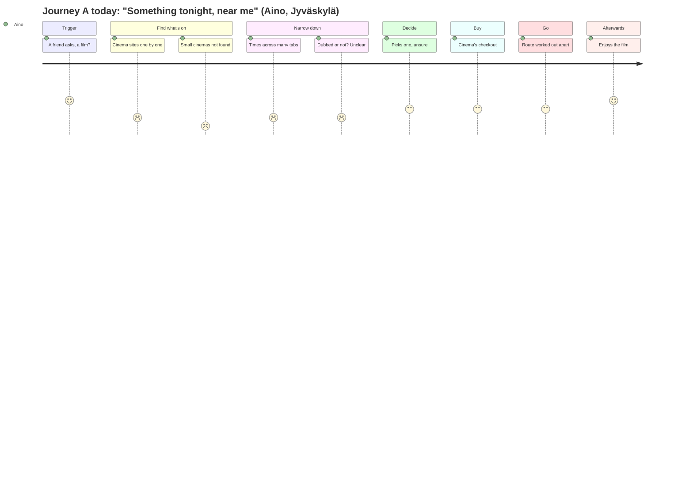
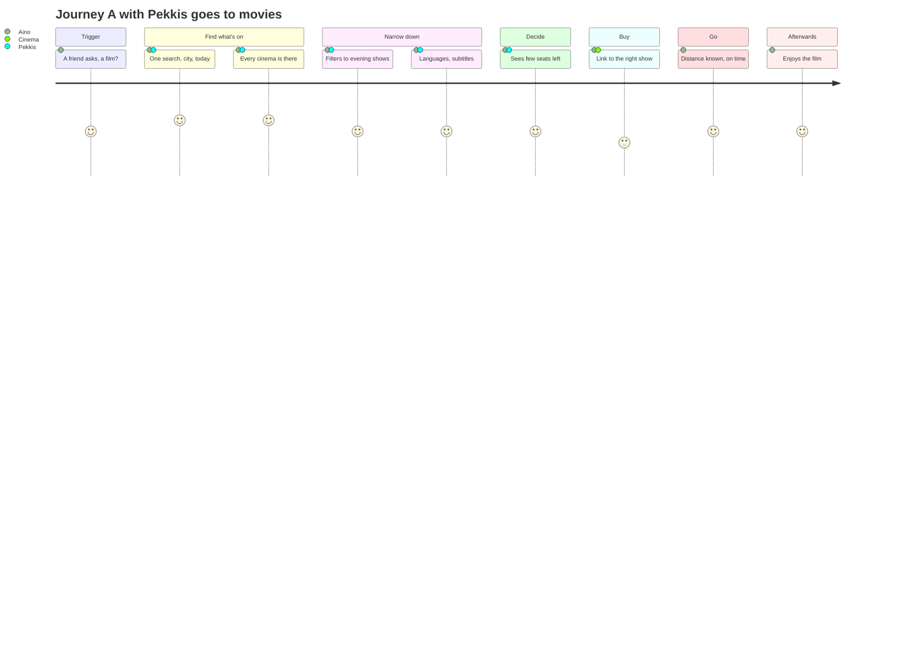
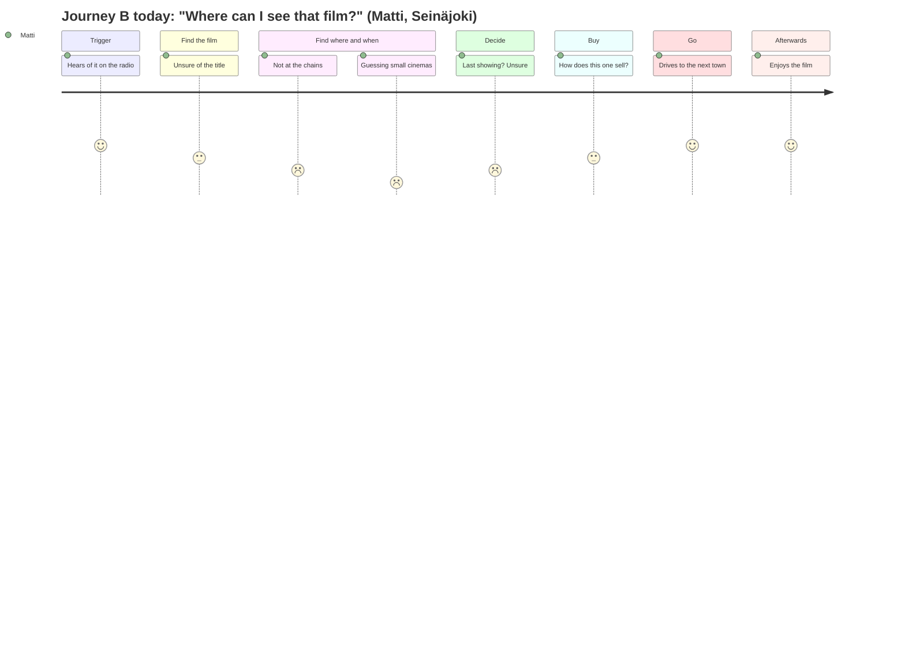
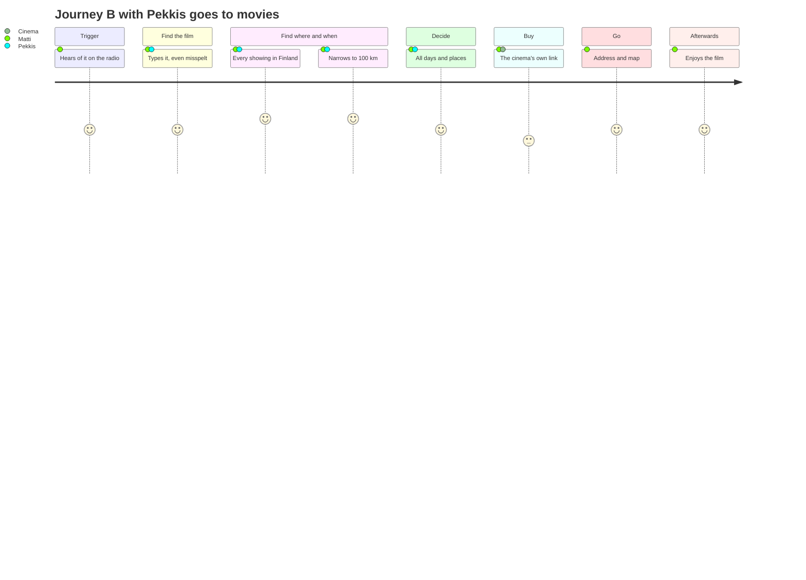

# Customer journey maps

How a person gets from "I'd like to see a film" to sitting in the cinema, today and with Pekkis goes to movies. There is one map for each of the service's two ways in: **time and place first**, and **film first** (see [AGENTS.md](../../AGENTS.md#what-this-is)).

**Status: a first draft, 2026-10-21, for the mockup presentation on 2026-10-23.** Everything here is our assumption **[A]**, not yet research. Each pain point is a hypothesis for the questionnaire and the user tests to confirm or refute. When results come in, mark the confirmed parts **[V]** with their source.

How to read a map:

- **Columns** are the stages of the journey.
- **Rows** show what the person does, thinks and feels at each stage, where they meet a service (touchpoints), what hurts (pain points), and what we can do about it (opportunities).
- **The feeling** is scored 1–5 (1 frustrated, 5 happy) and drawn as a curve. It is drawn twice: once for the journey today, and once with our service.

The diagrams are Mermaid `journey` charts. GitHub renders them in place; for slides, export them as images.

---

## Journey A: "Something tonight, near me" (time and place first)

**Persona: Aino, 24, a student in Jyväskylä.**

- Thursday, 16:30. Lectures are over, and a friend suggests a film tonight.
- No particular film in mind: anything that's good, starts after 18:00 and is within walking or bus distance.
- Uses a phone for everything; a student budget.
- Knows the big cinema in the city centre, but not the small ones.

**Goal:** a good show tonight, close by, with tickets bought, in a few minutes.

| Stage               | 1. Trigger                           | 2. Find what's on                                                     | 3. Narrow down                                                                     | 4. Decide                                       | 5. Buy                                            | 6. Go                                               | 7. Afterwards                               |
| ------------------- | ------------------------------------ | --------------------------------------------------------------------- | ---------------------------------------------------------------------------------- | ----------------------------------------------- | ------------------------------------------------- | --------------------------------------------------- | ------------------------------------------- |
| **Does**            | Agrees to go; opens the phone        | Opens one cinema's site after another, or searches "leffat jyväskylä" | Compares times, films, languages; asks the friend                                  | Picks a show both can make                      | Follows the cinema's ticket link, pays            | Walks or takes the bus; arrives in time             | Talks about the film; maybe plans again     |
| **Thinks**          | "What's on, anything good?"          | "Is there something besides Finnkino?"                                | "Is this dubbed? What time does it end?"                                           | "Is there a better option I missed?"            | "Hope there are seats left"                       | "Will we make it?"                                  | "We should do this more often"              |
| **Touchpoints**     | Messaging app                        | Each cinema's own site, search engine, social media                   | Cinemas' sites, the chat with the friend                                           | –                                               | The cinema's ticket page                          | Map app, bus                                        | Social media, chat                          |
| **Pain points**     | –                                    | Every cinema on its own site; small cinemas hard to find at all       | No single view; languages and subtitles unclear; times spread across many tabs     | Uncertainty: alternatives not seen together     | Every cinema's checkout is different              | Distance and travel time not shown                  | Nothing to come back to                     |
| **Opportunities**   | Something to send the friend: a link | **All the cinemas in one search by place and day** (`/fi/haku`)       | **Filters by time of day, cinema and film; languages and subtitles on every show** | **Live status:** "starts in 30 min", "few left" | **A direct link to the right show's ticket page** | **Distance in the results; the map** (`/fi/kartta`) | Ideas: "coming soon", reminders (not built) |
| **Feeling today**   | 4 · interested                       | 2 · frustrated                                                        | 2 · confused                                                                       | 3 · unsure                                      | 3 · neutral                                       | 3 · rushed                                          | 4 · satisfied                               |
| **Feeling with us** | 4 · interested                       | 5 · relieved                                                          | 4 · in control                                                                     | 4 · confident                                   | 3 · neutral (still the cinema's checkout)         | 4 · on time                                         | 4 · satisfied                               |

---

## Journey B: "Where can I see that film?" (film first)

**Persona: Matti, 58, lives in Seinäjoki.**

- Heard about a film on the radio: a Finnish documentary, or an old classic back on the big screen.
- Wants to know whether it plays anywhere nearby, and when; willing to drive an hour for the right film.
- Uses a laptop at home and a phone on the move.
- Doesn't know which cinemas might show it: the big chains rarely show this kind of film.

**Goal:** find where and when the film plays within reasonable distance, and not miss it.

| Stage               | 1. Trigger                                        | 2. Find the film                                      | 3. Find where and when                                                      | 4. Decide                                                                                     | 5. Buy                                                                                           | 6. Go                                 | 7. Afterwards                                               |
| ------------------- | ------------------------------------------------- | ----------------------------------------------------- | --------------------------------------------------------------------------- | --------------------------------------------------------------------------------------------- | ------------------------------------------------------------------------------------------------ | ------------------------------------- | ----------------------------------------------------------- |
| **Does**            | Hears about the film; remembers its name, roughly | Searches the web with the name, maybe misspelt        | Checks the chains' sites, then guesses at small cinemas, film clubs, events | Picks a day and a place; maybe a longer drive                                                 | Follows the ticket link, or pays at the door                                                     | Drives to a town nearby               | Recommends it; looks for similar films                      |
| **Thinks**          | "That sounds like something for me"               | "What was it called in Finnish?"                      | "Is this only in Helsinki?"                                                 | "Is it worth the drive? Is this the last showing?"                                            | "Can I buy online, or only at the door?"                                                         | "Where do I park?"                    | "Where do I find more like this?"                           |
| **Touchpoints**     | Radio, newspaper, a friend                        | Search engine                                         | Chains' sites, small cinemas' own pages, Facebook, event calendars          | –                                                                                             | The cinema's ticket page, or the door                                                            | Car, map app                          | Friends, social media                                       |
| **Pain points**     | –                                                 | Finnish, Swedish and original titles differ; spelling | Small and touring screenings are scattered or not online in a findable way  | No overview of all showings; last showings missed                                             | Booking practices differ by cinema                                                               | –                                     | No way to follow a film or a series                         |
| **Opportunities**   | –                                                 | **Typo-tolerant search in any title language**        | **Every showing nationwide in one place, nearest first**                    | **The film page: all days and places.** A "last showing" mark: the data has it, not shown yet | **The cinema's own link.** What it leads to (buy, reserve, door): the data has it, not shown yet | **Address and map on the venue page** | Ideas: follow a film or a series, re-run alerts (not built) |
| **Feeling today**   | 4 · curious                                       | 3 · unsure                                            | 1 · frustrated                                                              | 2 · worried about missing it                                                                  | 3 · neutral                                                                                      | 4 · expectant                         | 4 · satisfied                                               |
| **Feeling with us** | 4 · curious                                       | 4 · found it                                          | 5 · relieved                                                                | 4 · confident                                                                                 | 3 · neutral                                                                                      | 4 · expectant                         | 4 · satisfied                                               |

---

## What the maps tell us

- **The biggest gain is in finding and comparing** (stages 2–4): the scattered information is the problem both personas share. That's what the service is built around: 157 venues in 110 cities in one place.
- **Buying stays at the cinema** (stage 5): we link to each cinema's own ticket page and never sell tickets. The feeling there doesn't improve with us, and that's by design. The opportunity is to make the handover clear: which show the link opens, and whether it buys, reserves or only informs (the data knows; the website doesn't say yet).
- **Small and touring cinemas** are where film-first users hurt most, and where we differ most from the chains' own sites.
- **Afterwards** (stage 7) is empty in both maps: following films, series or re-runs is a possible next step, not built.

## Hypotheses to test

For the questionnaire and the user tests:

1. People check several cinemas' sites before deciding. How many, and do they know the small cinemas?
2. Language and subtitles matter when choosing (dubbed or original, subtitled or not).
3. People mostly start from time and place, not from a film. Or the other way round?
4. Distance and travel time affect the choice, and a radius in kilometres is a natural way to say "near".
5. Leaving our site to buy from the cinema is acceptable.
6. People want to be told when a film comes to a cinema near them.
